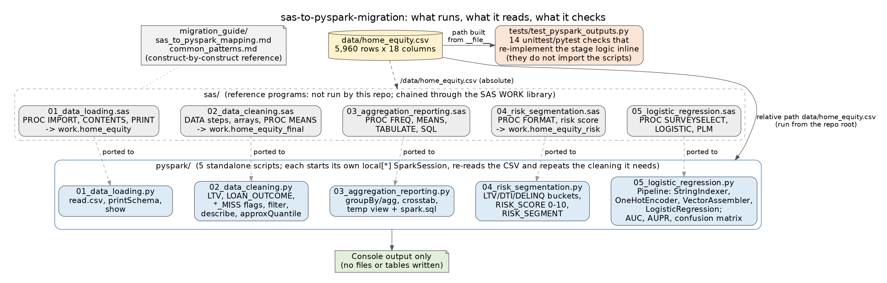

# Architecture

This repository is a side-by-side migration demo, not a deployed service. It holds five SAS programs, their PySpark ports, one dataset, a test suite and a written migration guide. This page describes how those parts relate on `main`.

The diagram source is [`diagrams/architecture.dot`](diagrams/architecture.dot) (Graphviz). After editing it, run [`diagrams/render.sh`](diagrams/render.sh) to regenerate `architecture.png` and `architecture.svg`.

## Components

| Path | What it is | Runs? |
|---|---|---|
| `data/home_equity.csv` | Home equity loan dataset, 5,960 rows x 18 columns. The only input. | Read by every script and the tests |
| `sas/01`-`05_*.sas` | The original SAS programs, kept as the logic reference for each port. | No: nothing in the repo runs SAS |
| `pyspark/01`-`05_*.py` | The PySpark ports, one per SAS program. | Yes, each with `python pyspark/<script>.py` |
| `tests/test_pyspark_outputs.py` | 14 `unittest` checks (run with pytest or unittest). | Yes |
| `migration_guide/` | Construct-by-construct mapping and seven worked migration patterns. | Docs only |

## How the SAS programs and the PySpark scripts differ in structure

- **SAS chains its steps through the WORK library.** `01` imports the CSV from the absolute path `/data/home_equity.csv` into `work.home_equity`; `02` builds `work.home_equity_final` from it; `03` reads `home_equity_final`; `04` builds `work.home_equity_risk`; `05` models from `home_equity_risk`. The programs only work run in order in one SAS session.
- **Each PySpark script is standalone.** Every script starts its own `SparkSession` with `master("local[*]")`, reads `data/home_equity.csv` itself and repeats the cleaning it needs inline (scripts `03`, `04` and `05` each re-derive `LTV` and filter to non-null, positive `LOAN` and `VALUE`). No script reads another's output, so any one can run alone and in any order.
- **The CSV path is relative.** The scripts read `data/home_equity.csv` relative to the current working directory, so run them from the repository root; from anywhere else Spark fails with `PATH_NOT_FOUND`.
- **Output is console only.** The scripts print schemas, tables and metrics with `print`, `show()` and `printSchema()`, then call `spark.stop()`. Nothing is written to disk or a catalog; `03` registers a session-scoped temp view `home_equity` for its Spark SQL query.

## Stages

| # | PySpark script | Main operations | SAS constructs it replaces |
|---|---|---|---|
| 1 | `01_data_loading.py` | `spark.read.csv(inferSchema=True)`, column-label dictionary, `printSchema`, `count`, `show(20)` | `PROC IMPORT`, `PROC DATASETS` labels, `PROC CONTENTS`, `PROC PRINT` |
| 2 | `02_data_cleaning.py` | `LTV = MORTDUE / VALUE`, `LOAN_OUTCOME` from `BAD`, `initcap(CITY)`, `*_MISS` flags for 8 numeric columns, null filter, `describe` + `approxQuantile`, final filter `0 < LTV < 5`, `LOAN > 0`, `VALUE > 0` | DATA steps, arrays, `PROC MEANS` with percentiles |
| 3 | `03_aggregation_reporting.py` | `groupBy().count()` frequency tables, `groupBy().agg()` stats by outcome, `crosstab(JOB, REGION)`, default rate by `JOB` x `REGION`, Spark SQL top-10 states (`HAVING COUNT(*) >= 10`) | `PROC FREQ`, `PROC MEANS`, `PROC TABULATE`, `PROC SQL` |
| 4 | `04_risk_segmentation.py` | `when`/`otherwise` buckets for LTV, DTI (`DEBTINC`) and `DELINQ`; `RISK_SCORE` (0-10: LTV 0-3, DTI 0-3, DELINQ 0-2, DEROG 0-2); `RISK_SEGMENT` (Low < 3, Medium < 5, High < 7, else Very High); segment distributions and default rates | `PROC FORMAT`, scoring DATA step, `PROC FREQ`, `PROC MEANS` |
| 5 | `05_logistic_regression.py` | Complete-case filter, `randomSplit([0.7, 0.3], seed=42)`, `Pipeline` of `StringIndexer` + `OneHotEncoder` (`JOB`, `REASON`), `VectorAssembler` (8 numeric features), `LogisticRegression(regParam=0.01, elasticNetParam=0.8)`; confusion matrix, AUC, AUPR, accuracy/precision/recall/F1, probability distribution by outcome | `PROC SURVEYSELECT`, `PROC LOGISTIC` (stepwise selection approximated by L1-weighted elastic net), `PROC PLM` scoring |

## Tests

`tests/test_pyspark_outputs.py` starts one local `SparkSession` for the class and loads the CSV from a path built from `__file__`, so it works from any directory. The scripts are not importable modules (their names start with digits and their code runs at import), so the tests do not import them. Each test re-implements the relevant transformation inline and checks it: row and column counts, `LTV` and `LOAN_OUTCOME` derivation, null filtering, group counts, grouped statistics, the Spark SQL query, risk buckets, score range and segment labels, and that the logistic regression pipeline trains with an AUC above 0.5. A change to a script's logic is therefore not caught unless the matching test is changed too.

## Runtime

- Spark runs in local mode (`local[*]`): PySpark launches a local JVM that runs the driver and executor threads and talks to Python over Py4J. Java is required, but there is no cluster, database or external service.
- `pip install pyspark` currently installs PySpark 4.x, which needs Python 3.11+ and Java 17+. `pyspark.ml` (script 5 and its test) also needs `numpy`.
